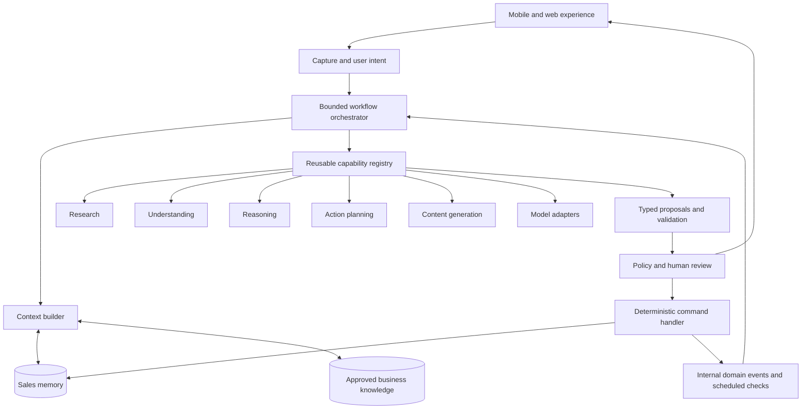

# Core functional architecture

Status: design proposal. Logical components, not a deployment or microservice prescription.

## Layers and ownership

| Component | Responsibility |
|---|---|
| Experience | Mobile capture, review, customer dossier, daily priorities, chat; web for longer review |
| Orchestrator | Select workflow, retrieve scoped context, call capabilities, enforce time/tool budgets, persist state |
| Understanding | Transcribe audio via adapter; extract structured observations, entities and evidence |
| Research | Retrieve permitted external or internal information; return source-attributed facts, not raw mass contacts |
| Reasoning | Analyze commercial implications, identify unknowns, rank options with explanations |
| Action planning | Extract commitments, propose reminders/tasks, check conflicts and duplicates |
| Content | Produce briefings and drafts grounded in approved knowledge |
| Memory | Persist confirmed observations, relationships, commitments, tasks and revision history |
| Policy and command handler | Validate schemas, permission, version, evidence, identity and idempotency; apply approved changes |
| Model adapters | Swappable ASR/LLM/embedding interfaces; typed responses, timeout, usage metadata; no direct writes |

Do not build separate agents per funnel stage. Start with a deterministic Capture workflow and add bounded planning when a measurable task requires it. An agent may read permitted context and return proposals; only the command layer writes authoritative records. Provider outputs are untrusted data, including prompt injection in transcripts or documents.

## Memory model

- Customer memory: accounts, locations, contacts, opportunities, observations and interaction history.
- Business knowledge: versioned, approved product facts, pricing, policies, playbooks and FAQ.
- Operational memory: commitments, tasks, due dates, ownership and execution state.
- Intelligence memory: aggregate signals derived from evidence, not an uncontrolled overwrite of factual memory.

Structured records are authoritative; semantic retrieval is optional and derived. Keep provenance, author, observation date, tenant, status and revision. Distinguish user-reported facts, verified facts, inferences and recommendations. A later conflicting note creates a conflict to resolve, not silent replacement.

## Events and workflow state

Examples: CaptureSubmitted, TranscriptReady, CaptureAnalysisReady, CaptureApproved, ObservationRecorded, TaskCreated, TaskDue, TaskCompleted. Event schemas should be versioned and carry tenant, actor, entity and correlation IDs. Internal events are logical contracts; no broker choice yet.

A workflow can be resumed from a durable checkpoint. Retry transient failures with bounds; retain successful stages and use idempotency keys for writes. Avoid circular triggers; a task created by capture must not re-run capture. Use optimistic concurrency for memory edits; re-review stale proposals. Partial failures remain visible and recoverable. Audit every material transition and model/schema/config version. Model outputs must not bypass approval.

## Autonomy levels

- Automatic: transcription, extraction, retrieval, internal analysis, draft generation and deterministic validation.
- Confirm first (initial release): entity linking when ambiguous, creating/updating commercial facts, creating tasks/reminders from notes, opportunity changes.
- Never in current product: sending messages or calls, making price promises, changing contracts, recording third parties, deleting authoritative records autonomously.

After validation, low-risk internal actions may support tenant-configured opt-in automation with undo and audit. All scopes must be enforced in storage and retrieval, including manager views. Encrypt sensitive data, define retention and deletion, exclude raw notes/PII from operational logs, and assess external model data processing before real use.

## Testability and model portability

Use contracts for transcription, reasoning, retrieval, clock, storage and actions; fixture implementations must run the entire capture flow locally without external services. Model-assisted evaluation is supplementary to human-labeled examples and deterministic invariants. Prefer open-source components where practical, commercial LLM APIs through adapters where justified by evaluations. No vendor, CRM, API channel, cloud or mobile framework selected in this document.

## Initial delivery slice

Voice/text input → transcription or text normalization → context → observations/analysis/action proposals → human review → atomic internal commit → dossier and task view. Keep the whole slice useful without external integrations.
