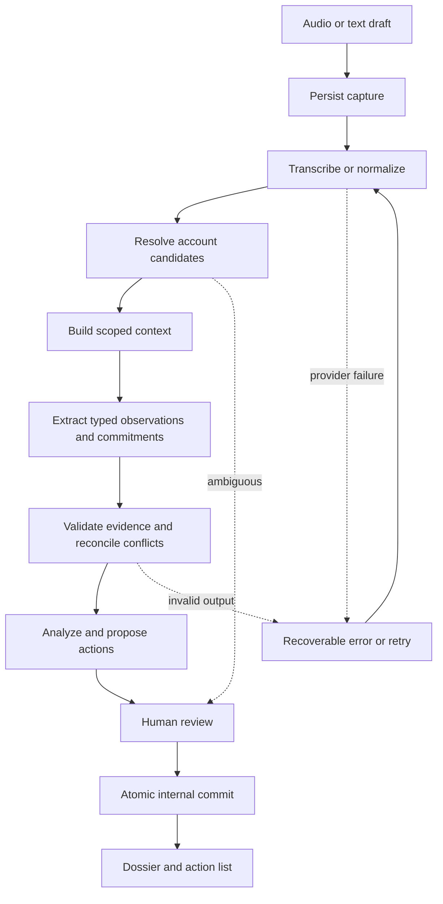

# Sales Capture — Domain and processing design

Status: conceptual contracts for implementation. Identifiers below are domain types, not prescribed tables or service endpoints.

## Core entities

| Entity | Essential data |
|---|---|
| Account / Location / Contact | tenant, id, identity attributes, relationships, status, version |
| Opportunity | account, product, stage, owner, status, version |
| Capture | id, tenant, actor, primary account hint, recorded_at, timezone, input type, processing status, draft reference |
| Transcript | capture, revision, text, language, optional timed segments, ASR metadata, author |
| Evidence | capture id, transcript revision, character span or segment id, quote, optional audio timestamps |
| Observation | target, field or typed kind, value, qualifier, source evidence, asserted_by, observed_at, status, revision |
| Analysis | capture, contextual snapshot/version, summary, inferences, gaps, cited evidence, model/config metadata |
| Commitment | actor, beneficiary/target, explicit promise, due date if known, evidence, status |
| ActionProposal | target, kind, rationale, source, explicit vs suggested, owner, due/date precision, review status, dedupe key |
| Task / Reminder | approved action id, owner, due, state, source, completion and revision data |
| ReviewDecision | actor, item id, edited value, decision, timestamp, proposal version |
| VerticalPack | schema version, products, types, extraction vocabulary, rules and approved knowledge references |

Every entity scoped by tenant; authorization also checks actor and account membership. Identifiers and scope come from application context, not LLM-generated authority.

## Logical processing



In the ambiguous-account branch, resolve the identity and rebuild context before any account-specific analysis is committed. When context is unavailable, use only the capture and approved tenant-level knowledge, and mark the analysis preliminary. Stage retries resume the failed checkpoint, not necessarily transcription.

1. Ingest: validate input, size, ownership and consent/policy; allocate immutable capture ID; persist encrypted draft.
2. Transcribe: ASR adapter or text passthrough. Normalize without changing meaning. Save transcript revision and optional timings. Editing invalidates derived proposals tied to older transcript.
3. Resolve identity: explicit selected account first; deterministic identifier matches next; scoped candidate ranking if needed; never fuzzy-merge. User confirmation gates ambiguity. Unknown account may remain unassigned draft.
4. Context: confirmed recent observations, relevant active opportunities, open tasks, approved product/playbook subset. Bound retrieval by permissions, token budget and recency; preserve contradictory evidence.
5. Extract: schema-constrained model output; classify reported statement, explicit commitment and unknown. Validate exact transcript evidence, types, units and negation; no invented values.
6. Reconcile: compare proposed observations with current memory; classify new, unchanged, conflict or potential update. Retain historic facts; surface conflicts and latest timestamps.
7. Analyze: cite observation/evidence references; propose commercial fit, blockers and gaps. Separate subjective inference from factual state. Use approved product facts only.
8. Plan: separate explicit commitments from suggested actions. Normalize dates with capture timezone and precision; unclear due dates remain null. Check existing tasks and propose duplicate resolution. External communication is only a human task or draft.
9. Review: show proposed diffs and evidence. Revalidate identity, schema, permissions and versions at commit; stale proposals require review.
10. Commit: transactional or equivalent atomic semantics for selected internal updates and tasks, with outbox/event record if later needed. Use unique idempotency keys per approved revision/action. No externally visible side effects.

## Illustrative typed response

```json
{
  "schema_version": "capture-analysis.v1",
  "capture_id": "cap-example",
  "transcript_revision": 1,
  "account_resolution": {"status": "needs_confirmation", "candidate_ids": []},
  "observations": [
    {
      "kind": "location_count",
      "value": 3,
      "qualifier": "reported",
      "evidence": {"quote": "Lo studio ha tre sedi.", "start": 0, "end": 22},
      "status": "proposed"
    }
  ],
  "insights": [{"kind": "opportunity", "text": "Potential multi-site opportunity", "observation_refs": [0], "status": "inference"}],
  "action_proposals": [
    {
      "kind": "human_follow_up",
      "title": "Richiamare lo studio",
      "origin": "explicit_commitment",
      "due_date": "2026-12-01",
      "due_precision": "day",
      "timezone": "Europe/Rome",
      "status": "proposed",
      "evidence": {"quote": "richiamarlo martedì prossimo"}
    }
  ],
  "open_questions": ["Who has final decision authority?"]
}
```

Illustrative fragment, not a finalized JSON Schema: production evidence uses validated zero-based half-open spans or segment IDs for every factual claim and commitment. Model outputs are rejected or repaired within bounded attempts if invalid. IDs, actual owner, tenant, dates and dedupe keys are resolved/validated by deterministic code.

## State and failure handling

Capture: draft → submitted → transcribing (audio only) → resolving → analyzing → awaiting_review → committed. Additional recoverable state: failed(stage, reason); discarded is terminal for an uncommitted draft. Ambiguity can pause at resolving. Edits increment transcript version and invalidate dependent analysis; reprocess only affected stages. Committed notes can have correction revisions without erasing history.

Action proposals: proposed → approved/rejected/superseded. Approved internal task: open → completed/cancelled, with optional snooze and audit. Drafts never imply an external send. Use stable action IDs and semantic duplicate candidate detection; exact replay must produce zero duplicates. Keep external model calls out of the commit transaction.

## Evaluation and implementation boundaries

A single process with modular interfaces is adequate initially; not a decision to use distributed queues, vector databases, or a particular agent framework. Use test doubles for ASR, LLM, clock and persistence. Optional model API evaluations operate on synthetic or approved minimized data. Raw audio lifetime, sync/processing modes and deletion policies are unresolved. Retention and authorized access must cover audio, transcript, derived facts and audit data without exposing payloads in logs.
